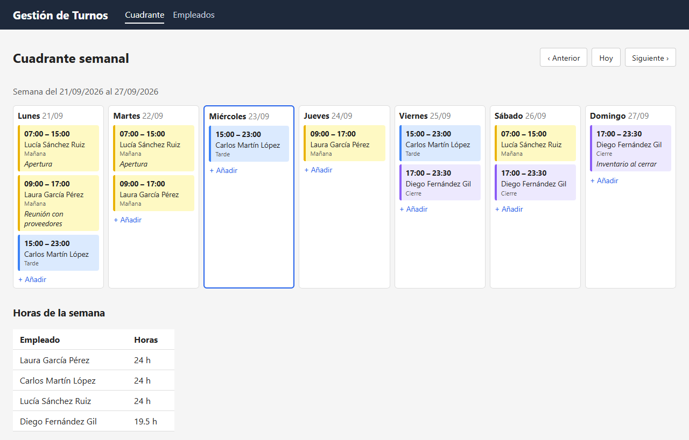
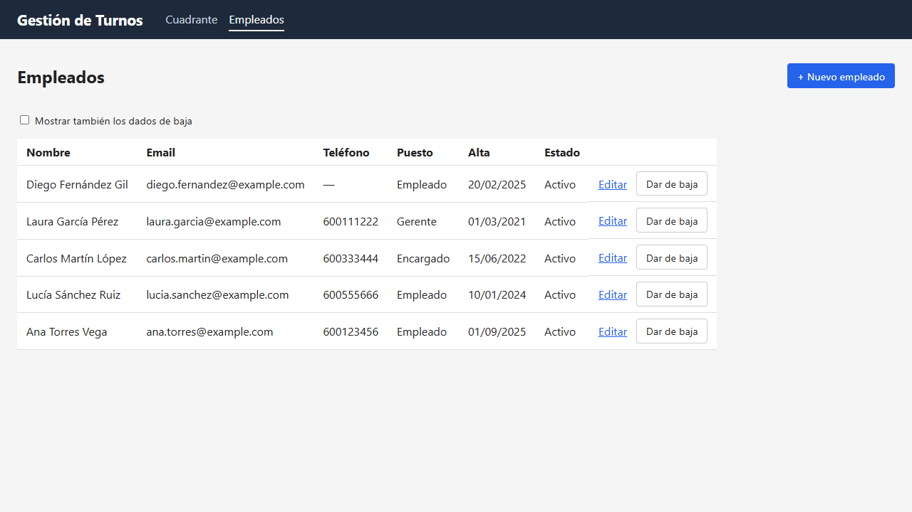
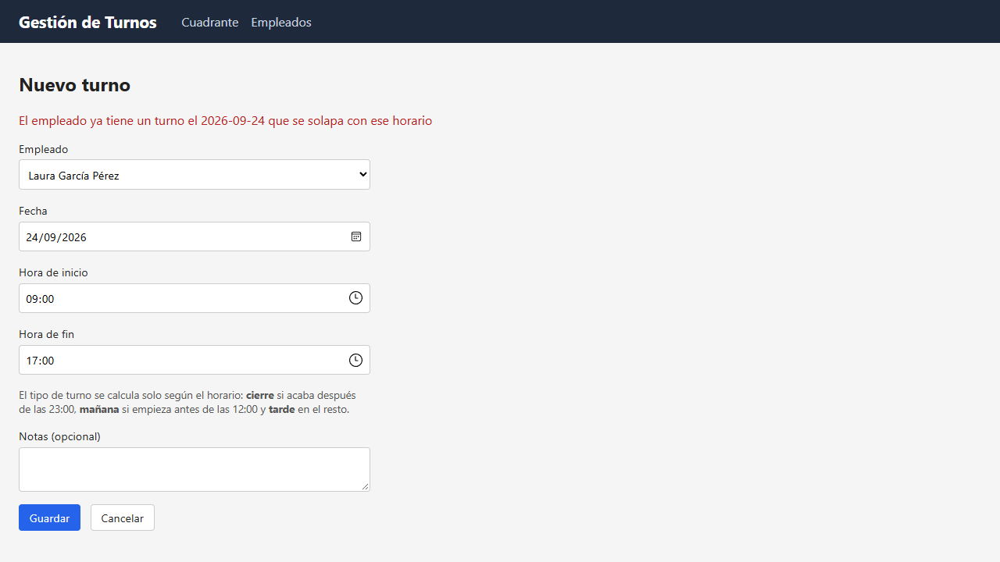

# Gestión de Turnos · Frontend

Aplicación web en **Angular** para gestionar el personal de un restaurante: cuadrante semanal de turnos y empleados.

Es el frontend de la API REST [gestion-turnos](https://github.com/NottWald0/gestion-turnos) (Java + Spring Boot). Toda la lógica y las reglas de negocio viven en la API; esta aplicación las consume y muestra sus respuestas.

## Capturas

**Cuadrante semanal**: turnos de lunes a domingo, coloreados por tipo (mañana, tarde, cierre), y horas de cada empleado.



**Empleados**: alta, edición, baja y reactivación.



**Formulario de turno**: los errores de la API se muestran en pantalla (aquí, un turno que se solapa con otro).



## Funcionalidades

- Cuadrante semanal con navegación entre semanas y resumen de horas por empleado.
- Crear, editar y eliminar turnos desde el propio cuadrante.
- Lista de empleados con filtro de dados de baja; alta, edición, baja y reactivación.
- Errores de la API mostrados en el formulario:
  - **400** (datos no válidos): debajo de cada campo.
  - **409 / 422** (email duplicado, turnos solapados, más de 40 h semanales…): mensaje general arriba.

## Stack

- **Angular 22** con componentes *standalone* y **signals**
- **TypeScript**
- **Formularios reactivos**, **Router** y **HttpClient**
- CSS propio, sin librerías de componentes

## Cómo ejecutarlo

Requisitos: **Node.js** (probado con la versión 24) y la API en marcha.

1. Arranca la API siguiendo su [README](https://github.com/NottWald0/gestion-turnos#cómo-ejecutarlo). La forma más rápida:
   ```bash
   docker compose up --build   # en la carpeta del backend
   ```
2. Instala las dependencias y arranca el frontend:
   ```bash
   npm install
   npm start
   ```
3. Abre http://localhost:4200

## Cómo se conecta con la API

En desarrollo, el servidor de Angular hace de **proxy** ([proxy.conf.json](proxy.conf.json)): las peticiones a `/api/...` se reenvían a `http://localhost:8080`. Para el navegador todo viene del mismo origen (`localhost:4200`), así que no hace falta configurar **CORS** en la API.

## Estructura

```
src/app/
├── comun/          utilidades compartidas (fechas, lectura de errores de la API)
├── empleados/      modelo, servicio HTTP, lista y formulario de empleados
├── turnos/         modelo, servicio HTTP, cuadrante semanal y formulario de turnos
├── app.routes.ts   rutas de la aplicación
└── app.config.ts   configuración global (router, HttpClient)
```

Organizado **por funcionalidad**, igual que el backend (`empleado/`, `turno/`).

## Decisiones técnicas

- **Interfaces TypeScript que reflejan los DTOs de la API** (`Empleado`, `Turno`, `CuadranteSemanal`…), para que el compilador detecte errores de tipos.
- **Servicios para las llamadas HTTP** y componentes solo para la pantalla: cada capa tiene una responsabilidad, igual que Controller / Service en el backend.
- **Las validaciones las hace la API**, que es la única fuente de verdad; el frontend muestra sus mensajes (ya en español) en el campo correspondiente.
- **El estado de navegación va en la URL** (`/cuadrante?fecha=…`, `/empleados?bajas=true`): se conserva al volver de un formulario y al recargar la página.
- **Signals** para el estado de cada pantalla: al cambiar un valor, Angular actualiza solo lo que depende de él.
